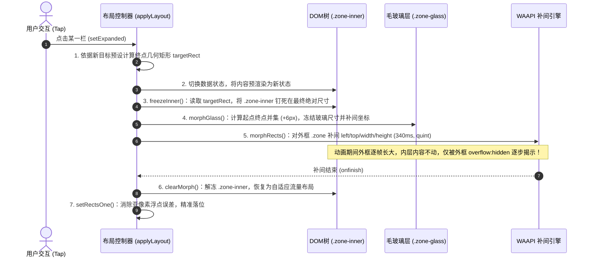

# 02 · 容器变形与毛玻璃优化架构 (Container Morphing & Glassmorphism Optimization)

本文档深入解析流体物理动效系统中**最具突破性的两大工程实现**：
1. **真实几何补间与内容冻结技术（Freeze-Inner Geometry Tweening）**：彻底解决卡片缩放时“文字拉伸变形”与“逐帧重排掉帧”的经典困境。
2. **毛玻璃层并集冻结渲染（Union Bounding Box Glass Optimization）**：根治多层移动设备 WebView 在补间中计算 `backdrop-filter` 导致的 GPU 掉帧。

---

## 1. 经典困境与核心问题分析

在响应式 UI 或多栏自适应界面中，当用户点击某张卡片使其“聚焦放大”（如多栏中的某一栏占据 70% 宽度，另外两栏退居侧边缩略）时，传统前端方案存在两大致命缺陷：

### 缺陷 A：CSS `transform: scale(x, y)` 变形失真
- 若直接对容器应用 `transform: scale()`，容器内的文字、边框、图标、圆角均会被机械拉伸或挤压，文字在动画期间变得模糊失真，收尾瞬间由于重排而产生刺眼的“跳动”。

### 缺陷 B：CSS `width / height / left / top` 逐帧重排 (Reflow Storm)
- 若改用 CSS Transition 补间宽高，浏览器必须在每一帧对容器内部的所有子节点（例如复杂数据网格、多列子卡片）重新进行流式布局计算（Layout/Reflow），在移动端直接导致掉帧至 20~30fps。
- 此外，若卡片包含 `backdrop-filter: blur(...)`，浏览器必须针对每一帧的新尺寸重新分配纹理并执行多通道高斯模糊卷积计算，GPU 负载直接打满。

---

## 2. 真实几何补间与“内容冻结”架构 (Freeze-Inner Architecture)

系统提出并实现了**DOM 三层解耦模型**：

```
┌────────────────────────────────────────────────────────┐
│ .zone (外层栏框)                                        │
│  - 纯几何坐标：left, top, width, height                 │
│  - 样式属性：overflow: hidden; border-radius           │
│  - 负责行为：在 WAAPI 中执行真实的物理几何尺寸补间      │
├────────────────────────────────────────────────────────┤
│   ┌──────────────────────────────────────────────────┐ │
│   │ .zone-glass (独立磨砂玻璃层)                      │ │
│   │  - 尺寸：起止矩形并集 (Union Rect)               │ │
│   │  - 负责行为：尺寸在动画全程冻结，仅滑动位移       │ │
│   └──────────────────────────────────────────────────┘ │
│   ┌──────────────────────────────────────────────────┐ │
│   │ .zone-inner (内容承载层)                         │ │
│   │  - 动画期间：position: absolute; flex: none;     │ │
│   │  - 尺寸锁定：精准固定在【最终目标宽高】           │ │
│   │  - 负责行为：文字一次性排版定稿，全程零重排       │ │
│   │  ┌────────────────────────────────────────────┐  │ │
│   │  │ .zone-body (具体视图组件：表格/清单/卡片)   │  │ │
│   │  │  - 纯视觉层：仅执行 opacity / transform    │  │ │
│   │  └────────────────────────────────────────────┘  │ │
│   └──────────────────────────────────────────────────┘ │
└────────────────────────────────────────────────────────┘
```

### 核心执行时序（精确到单帧编排）

当用户触发聚焦或收起动作时，执行严格的**五步时序**：



### 关键代码实现：`freezeInner` 与 `clearMorph`

```javascript
/**
 * 将内容层按“最终尺寸”钉住：
 * 内容一次性按最终宽度排好版，动画期间它一动不动，只是被父级的 overflow:hidden 一点点露出来。
 * left/top 严格采用栏框内边距，解冻后与正常流量布局无缝衔接，绝无跳动。
 */
function freezeInner(node, targetRect) {
  var inner = node.querySelector('.zone-inner');
  if (!inner) return;
  
  var cs = getComputedStyle(node);
  var padL = parseFloat(cs.paddingLeft) || 0;
  var padT = parseFloat(cs.paddingTop) || 0;
  var bw = (parseFloat(cs.borderLeftWidth) || 0) + (parseFloat(cs.borderRightWidth) || 0);
  var bh = (parseFloat(cs.borderTopWidth) || 0) + (parseFloat(cs.borderBottomWidth) || 0);

  inner.style.position = 'absolute';
  inner.style.left = padL + 'px';
  inner.style.top = padT + 'px';
  inner.style.width = Math.max(40, targetRect.w - bw - padL * 2) + 'px';
  inner.style.height = Math.max(40, targetRect.h - bh - padT * 2) + 'px';
  inner.style.flex = 'none';
  node.__frozenInner = inner;
}

/**
 * 补间收尾或被打断时的状态复原
 */
function clearMorph(node) {
  if (!node) return;
  if (node.__morph) {
    try { node.__morph.cancel(); } catch (e) {}
    node.__morph = null;
  }
  if (node.__frozenInner) {
    var f = node.__frozenInner;
    node.__frozenInner = null;
    f.style.position = '';
    f.style.left = '';
    f.style.top = '';
    f.style.width = '';
    f.style.height = '';
    f.style.flex = '';
  }
  var gl = node.querySelector('.zone-glass');
  if (gl && gl.__glassAnim) {
    try { gl.__glassAnim.cancel(); } catch (e) {}
    gl.__glassAnim = null;
  }
}
```

---

## 3. 毛玻璃渲染突破：并集冻结法 (`morphGlass`)

### 性能瓶颈根因
当对带有 `backdrop-filter: blur(Npx)` 的元素补间宽高时，GPU 必须在 60fps 的每一帧重新生成帧缓冲区并计算全尺寸模糊。移动端 GPU 瞬时算力无法承受该开销。

### 解决方案：并集包围盒固定尺寸法
1. 计算起点矩形 $A(x_a, y_a, w_a, h_a)$ 与终点矩形 $B(x_b, y_b, w_b, h_b)$ 的**最小外接矩形（Union Bounding Box）**，四周各扩充 6px 防锯齿余量：
   $$\begin{aligned}
   ux &= \min(x_a, x_b) - 6 \\
   uy &= \min(y_a, y_b) - 6 \\
   uw &= \max(x_a + w_a, x_b + w_b) + 6 - ux \\
   uh &= \max(y_a + h_a, y_b + h_b) + 6 - uy
   \end{aligned}$$
2. 将玻璃层 `.zone-glass` 的宽高直接**固定为 $uw \times uh$**。在整个 340ms 补间周期内，玻璃层的宽高**完全恒定**！
3. 玻璃层相对于父容器的相对坐标做反向平移补间：
   - 起点相对位移：$(ux - x_a, uy - y_a)$
   - 终点相对位移：$(ux - x_b, uy - y_b)$
4. **效果**：在绝对屏幕坐标系中，毛玻璃层是**静止**的，仅外层容器的裁切窗口在变大变小。`backdrop-filter` 在补间全程只光栅化一次，每帧消耗等同于普通位移，彻底消除模糊掉帧！

### 完整实现代码：`morphGlass`

```javascript
function morphGlass(node, a, b, dur, ease, delay) {
  var gl = node.querySelector('.zone-glass');
  if (!gl || !gl.animate) return;

  var pad = 6;
  var ux = Math.min(a.x, b.x) - pad;
  var uy = Math.min(a.y, b.y) - pad;
  var uw = Math.max(a.x + a.w, b.x + b.w) + pad - ux;
  var uh = Math.max(a.y + a.h, b.y + b.h) + pad - uy;

  gl.style.width = uw + 'px';
  gl.style.height = uh + 'px';

  if (gl.__glassAnim) {
    try { gl.__glassAnim.cancel(); } catch (e) {}
    gl.__glassAnim = null;
  }

  gl.__glassAnim = gl.animate(
    [
      { left: (ux - a.x) + 'px', top: (uy - a.y) + 'px' },
      { left: (ux - b.x) + 'px', top: (uy - b.y) + 'px' }
    ],
    {
      duration: dur,
      delay: delay || 0,
      easing: ease,
      fill: 'both'
    }
  );
}
```

---

## 4. FLIP 式打断与空中接力 (Interruption Continuity)

在高速连续交互场景（如用户快速反复点击卡片、或在放大未完成时立刻点击收起），若机械地拿上一次的目标值作为新动画的起点，画面会发生明显的瞬移跳变。

系统采用 **实时几何捕获（`currentRects`）** 进行飞行中状态接力：

```javascript
function currentRects() {
  var host = Layout.el;
  if (!host) return null;
  var base = host.getBoundingClientRect();
  var out = {};
  for (var k in ZONE_IDS) {
    var z = document.getElementById(ZONE_IDS[k]);
    if (!z) continue;
    var r = z.getBoundingClientRect();
    // 捕获此刻在屏幕上的真实物理渲染几何（包含动画进行到一半的值）
    out[k] = {
      x: Math.round(r.left - base.left),
      y: Math.round(r.top - base.top),
      w: Math.round(r.width),
      h: Math.round(r.height)
    };
  }
  return out;
}
```

在 `applyLayout(animate)` 中：
```javascript
// 补间的起点用“此刻真实画在哪”，连续快点时上一段动画播到一半也能平滑反弹，零跳帧
var from = animate ? currentRects() : Layout.rects;
Layout.rects = target;
morphRects(from, target, { collapse: !isExpanded });
```

---

## 5. 多断点卡片内容宽度级联响应 (`applyZoneWidthClasses`)

当容器在几何补间中变宽时，内部组件需根据自身真实可用宽度自动分档，切换字体大小、间距与排版列数（规避旧版 WebView 缺乏 `@container` 支持的问题）：

```javascript
/**
 * 依据单栏实时内容宽度计算档位：
 * w-xs (<190px) | w-s (<300px) | w-m (<470px) | w-l (<700px) | w-xl (≥700px)
 */
function applyZoneWidthClasses(rects) {
  var pad = 14;
  for (var k in rects) {
    var z = document.getElementById(ZONE_IDS[k]);
    var r = rects[k];
    if (!z || !r) continue;
    var contentW = Math.max(0, r.w - 2 - pad * 2);
    var cls = contentW < 190 ? 'w-xs'
      : (contentW < 300 ? 'w-s'
        : (contentW < 470 ? 'w-m'
          : (contentW < 700 ? 'w-l' : 'w-xl')));
    
    ['w-xs', 'w-s', 'w-m', 'w-l', 'w-xl'].forEach(function(c) {
      if (c === cls) z.classList.add(c); else z.classList.remove(c);
    });
  }
}
```
通过该方案，无论是折叠屏展开、横屏切换还是聚焦放大，界面均在毫秒级自动适配最舒适的内容比例。
